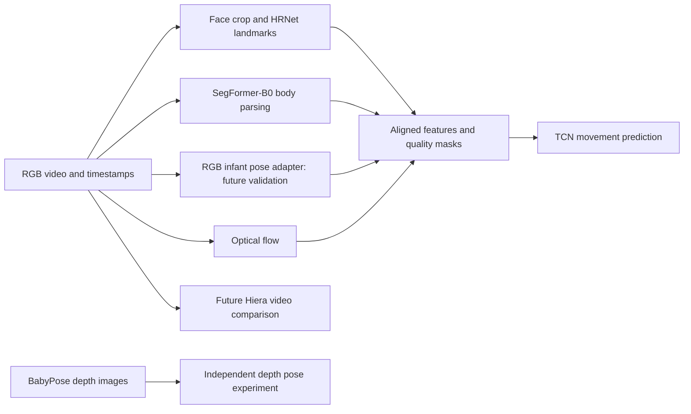

# Infant Movement Analysis Using Deep Learning

An independent, exploratory PyTorch research project for measuring infant facial geometry and body movement over time. The long-term question is whether validated movement measurements could support research into movements potentially associated with epileptic seizures.

**This is not a medical diagnostic system.** None of the candidate datasets is established here as providing clinically confirmed seizure events. Normative movement, neuromotor risk, facial expressiveness, and seizure status are different concepts; no conversion between these labels is permitted.

## Current status

**M1 metadata implementation completed on 27 October 2026**, within the user's authorization for package setup, minimal dependencies, and synthetic metadata/split checks. The package has no required runtime dependencies. Development and build tools are installed in an isolated local `.venv`; the tested versions and wheel hashes are recorded below. As inspected on 28 October, the current branch is `research/infanface-e0-audit`, tracking `origin/research/infanface-e0-audit`; `origin` is `https://github.com/sadia2102/baby-movement-ai.git`. The preprocessing milestone remains local and uncommitted; it performed no uploads or pushes.

**InfAnFace acquisition/schema audit and the first independent annotation reader completed on 27 October 2026.** Only the official InfAnFace archive was acquired for authorized private noncommercial E0 inspection. No model weights, models, training or inference are implemented. There are no scientific model results or audited patient/video-independent project splits; identity and source-video mappings remain UNVERIFIED. The reader preserves official metadata and fractional coordinates without assigning project partitions.

**Image loading and landmark preprocessing completed on 28 October 2026.** The existing optional Pillow decoder now supports local ZIP image loading, explicit crops, uniform resize/padding, EXIF frame handling and forward/inverse coordinate transforms. No dependencies were added or changed. **209 synthetic tests passed.** A separate local smoke check processed 410/410 stored rasters; normalization processed 409/410 and explicitly rejected one invalid EXIF orientation tag. Source coordinate conventions and anatomical alignment remain **UNVERIFIED**. See the [preprocessing report](reports/infanface-preprocessing-2026-10-28.md) and [environment record](environments/infanface-preprocessing.md).

- [Detailed research plan](research_plan.md): dataset evidence, experiment protocols, metrics, leakage controls, dependency recommendations, hardware strategy, and weaknesses.
- [Contributor and agent rules](AGENTS.md): scope boundaries and reproducibility requirements.
- [InfAnFace acquisition and annotation audit](reports/infanface-e0-acquisition-audit-2026-10-27.md): receipt/hash, observed schema, quality findings, provenance limits, and 121-test verification.
- [InfAnFace duplicate/provenance audit](reports/infanface-duplicate-provenance-audit-2026-10-27.md): decoded pixels, near-duplicate candidates, local source evidence, limitations and 150-test verification.

The [InfAnFace desk review](reports/infanface-e0-desk-review-2026-10-27.md) and acquisition audit remain unchanged historical records. The subsequent local duplicate audit verified and preserved the archive, decoded all 410 samples, found no exact decoded-pixel groups, and investigated 23 candidate pairs. One pair has plausible shared-scene content; 22 match mainly through presentation/layout. None crosses the official train/test boundary, which does not establish subject/video independence. Two unparsed XMP blocks and missing authoritative source mappings remain UNVERIFIED. No identities, source-video IDs or project splits were created.

## Proposed research architecture



Facial landmarks describe geometry; expression recognition requires additional validated expression labels. Segmentation measures body regions and gates flow, while pose measures joints. These branches meet only when observations refer to the **same video and timestamps**. BabyPose depth supervision remains a separate experiment; it does not supply RGB labels.

## Independent experiments

| ID | Experiment | Supervision / output |
|---|---|---|
| E0 | Provenance, annotation, and split audit | Dataset-specific manifests and leakage report |
| E1 | HRNet facial landmark adaptation | InfAnFace landmarks; normalized localization errors |
| E2 | SegFormer-B0 body parsing | YouTube Infant Body Parsing masks; region overlap |
| E3 | Infant depth-pose adaptation | BabyPose joints; 2D localization errors |
| E4 | Movement features and causal TCN | Chambers pose sequences; nonclinical forecasting |
| E5 | Modular video integration | Synchronized permitted RGB videos; quality and robustness |
| E6 | Deferred Hiera video comparison | Same eligible forecasting target and held-out groups |

These datasets must never be concatenated into a single supervised dataset. E1–E4 have separate adapters, label schemas, configurations, checkpoints, and reports. E5/E6 are conditional on access and validated inputs.

## Repository layout

```text
README.md / AGENTS.md / research_plan.md
pyproject.toml    # Installable package, development tools, lint/test configuration
configs/
  datasets/       # One schema and configuration per dataset
  models/         # Architecture, source revision, checkpoint identity
  experiments/    # E0–E6 resolved protocols, created after review
  environments/   # CPU / Apple MPS / optional later CUDA overrides
src/infant_movement/
  datasets/       # Metadata envelope and independent InfAnFace annotation reader
  models/         # Face, segmentation, depth pose, RGB pose, TCN adapters
  features/       # Geometry, flow, timestamps, missingness
  engine/         # Training, checkpointing, inference, device selection
  evaluation/     # Grouped checks, whole-image candidates and local XMP references
  utils/          # Config, seeding, provenance, hashing
scripts/          # Explicit local-source metadata audit; training tools deferred
tests/            # Synthetic metadata, reader, image, provenance and CLI checks
manifests/        # Private actual sample, identity, and split records
data/{raw,interim,processed}/  # Local ignored assets, kept separate by dataset
artifacts/{checkpoints,features}/  # Local ignored derived artifacts
reports/          # Shareable aggregate reports after disclosure review
notebooks/        # Exploration using package code, not training logic
environments/     # Tested M1 development lock and environment/verification record
```

The original folder structure and `research_plan.md` are preserved. The plan records the original proposals and 18 October evidence snapshot; README and dated reports record implementation status. InfAnFace supervision stays separate from other datasets. The core package has no required runtime dependencies; image decoding uses only the optional hash-locked Pillow extra.

## Development environment

Verified for M1: **CPython 3.13.3, macOS 27.0.1, arm64**, with the exact tools in [the development lock](environments/macos-arm64-py313-dev.lock). See [the environment and verification record](environments/m1-environment.md). Python 3.11 remains the plan's proposed future training baseline; it was not installed for this standard-library-only milestone. Other Python versions, operating systems, and training/accelerator compatibility have not been verified. `requires-python >=3.11` is the code's intended minimum, not a tested compatibility matrix.

The existing `.venv` now also contains Pillow 13.0.0 for the bounded image audit. See [the optional decoder environment record](environments/infanface-image-audit.md) and [combined image-audit lock](environments/macos-arm64-py313-image-audit.lock). Historical M1 pins remain unchanged.

From the repository root, the existing environment is ready to use without activation:

```sh
.venv/bin/python -m pytest -q
.venv/bin/python -m ruff check .
.venv/bin/python -m ruff format --check .
.venv/bin/python -m pip --disable-pip-version-check --no-cache-dir check
.venv/bin/infant-movement audit tests/fixtures/synthetic_metadata.json
```

For a fresh checkout on the same platform with Python 3.13.3 already available, create the environment and install the hash-locked tools. The first installation command explicitly accesses the Python package index for packaging/testing tools only. It downloads wheels; it does not acquire research assets. The editable project installation then runs with network resolution disabled:

```sh
python3.13 -m venv .venv
.venv/bin/python -m pip --disable-pip-version-check --no-cache-dir install --only-binary=:all: --require-hashes -r environments/macos-arm64-py313-dev.lock
.venv/bin/python -m pip --disable-pip-version-check --no-cache-dir install --no-index --no-build-isolation --no-deps -e .
```

The lock includes pip, setuptools, wheel, pytest, Ruff, and all their installed dependencies. `pyproject.toml` also declares a pinned `dev` extra; use the lock above for the verified complete environment. Avoid installing an unpinned tool midway through a milestone. M1 needs no decoder, PyTorch, torchvision, notebook runtime or accelerator tooling. The optional image-audit extra adds only Pillow and also supports preprocessing; use its combined lock for the current full synthetic suite. Imports, audits, tests, and lint checks make no network requests. For offline recreation, obtain the locked wheels explicitly on an authorized connection, then add `--no-index --find-links /path/to/wheels` to the locked-tools install command. Hash checking follows [pip's documented installation mode](https://pip.pypa.io/en/stable/topics/secure-installs/); package configuration follows the [PyPA guide](https://packaging.python.org/en/latest/guides/writing-pyproject-toml/).

To verify a distributable wheel locally, after the checks above:

```sh
.venv/bin/python -m pip --disable-pip-version-check --no-cache-dir wheel --no-index --no-build-isolation --no-deps --wheel-dir dist .
```

`dist/`, `.venv/`, caches, and generated package metadata are ignored by Git. No license has been assigned to this project's code; dataset, original-media, and pretrained-weight permissions remain separate.

## InfAnFace local annotation reader

`infant_movement.datasets.infanface` provides `load_infanface_archive(path)` and `load_infanface_csv(path)`. Both read explicit local files and return immutable dataset-native samples. They perform no downloads, archive extraction, image decoding, split generation, or model inference.

The observed CSV contains 144 columns: four image/partition references, four binary attributes, and 68 `(x,y)` pairs. The reader checks finite coordinates, schema, reference safety, uniqueness, and official partition/attribute consistency. It preserves fractional and out-of-bounds source values. `landmark_bounds_mask(sample, width, height)` supplies a separate geometric QC mask; this is not a visibility annotation. The source pixel indexing origin remains UNVERIFIED.

For an aggregate local check of the already acquired archive:

```sh
.venv/bin/python - <<'PY'
from collections import Counter
from infant_movement.datasets.infanface import load_infanface_archive
samples = load_infanface_archive("data/raw/infanface/InfAnFace.zip")
print(len(samples), dict(Counter(s.official_split for s in samples)))
PY
```

Expected for the recorded receipt: 410 rows, with 210 `infanface-train` and 200 `infanface-test`. The archive SHA-256 and private evidence locations are recorded in the [acquisition audit](reports/infanface-e0-acquisition-audit-2026-10-27.md). An independent publisher checksum remains UNVERIFIED.

No subject/source-video IDs or project partitions are assigned. The private `manifests/infanface-unassigned-inventory-2026-10-27.json` intentionally does **not** satisfy the M1 split schema: unknown source groups and unassigned project partitions must not be fabricated to make an audit pass. Do not feed that inventory to the `audit` CLI as a claimed clean split. Every other dataset's supervision remains separate.

## Local duplicate and provenance audit

The completed [dated report](reports/infanface-duplicate-provenance-audit-2026-10-27.md) documents the fixed method and all aggregate findings. Exact equality uses dimensions plus decoded RGBA8 pixels, both stored and EXIF-oriented. Near-candidate screening uses whole-image dHash ≤6 **and** aHash ≤8 on the same view combination, testing full/central-80% views and mirrors. No face recognition, embeddings or infant identity assignment is used. Similarity is a review request, not duplicate/source confirmation.

All 83,845 pairs were compared. There were zero exact-pixel groups and 23 candidates, all within official training. All candidates were investigated; one remains a plausible shared-scene pair, while 22 are primarily layout/presentation matches. Source review found no confirmed video mapping; two XMP blocks remain unparsed/UNVERIFIED. These findings do not certify patient/video independence or justify a new independent split.

To recreate the optional decoder environment on this platform, explicitly install the hash-locked wheels and refresh the local editable package without dependency resolution:

```sh
.venv/bin/python -m pip --disable-pip-version-check --no-cache-dir install --only-binary=:all: --require-hashes -r environments/macos-arm64-py313-image-audit.lock
.venv/bin/python -m pip --disable-pip-version-check --no-cache-dir install --no-index --no-build-isolation --no-deps -e .
```

From the repository root, choose **new, unused** private output names:

```sh
.venv/bin/python -m infant_movement duplicate-audit --archive data/raw/infanface/InfAnFace.zip --receipt data/raw/infanface/acquisition-receipt-2026-10-27.json --output reports/private/infanface-duplicates-rerun.json
.venv/bin/python scripts/audit_infanface_sources.py --archive data/raw/infanface/InfAnFace.zip --audit-report reports/private/infanface-duplicates-rerun.json --output reports/private/infanface-sources-rerun.json
```

These commands read local files, verify archive integrity before/after, print aggregates and write per-sample evidence only under `reports/private`. They refuse overwriting and make no network requests or project assignments. Source-audit completion does not imply every XMP block parsed; inspect `xml_failure_count`. Original private audit JSON, contact sheets and review decisions remain Git ignored. Do not publish per-sample hashes, metadata or candidate edges. No images or data-dependent fixtures are embedded in tests.

## InfAnFace image loading and landmark preprocessing

`datasets.infanface_images.open_infanface_images(path, expected_sha256=...)` reads validated samples and exact JPEG/PNG ZIP members without extraction. It verifies the receipt digest before and after the context, rejects duplicate/missing/encrypted/oversized/symlink image members, and bounds decoded pixels. Loaded images are owned RGB rasters in stored orientation; transparency is composited over white. New rasters carry no original EXIF/XMP metadata. Raw files and the immutable annotation objects are preserved. Close loaded/prepared Pillow images after use; each loaded image remains usable after its archive context closes.

`preprocess_face` requires explicit `source_index_base`, `annotation_frame`, `orientation_policy`, `crop_box` and `output_size`. The output retains the original sample, transformed landmarks, 3×3 `forward.matrix` and `inverse.matrix`, crop/configuration details and separate `present`, `source_in_bounds`, `crop_in_bounds` and `output_in_bounds` flags. Out-of-bounds values are transformed without clipping; explicit `None` remains missing. The native annotation reader still rejects missing/nonfinite CSV values; it does not fabricate them. Geometric flags are not per-landmark visibility, occlusion, confidence or a preselected loss mask. A point outside the crop may map into output padding, so `output_in_bounds` alone is insufficient for supervision.

**Working convention:** pixel edges span `[0,width] × [0,height]`, with centres at `(column+0.5,row+0.5)`. Raster footprint flags are half-open `[0,width) × [0,height)`. Base 0 hypothesizes that raw `(0,0)` means the first pixel centre; base 1 hypothesizes raw `(1,1)`. Conversion adds `0.5 - source_index_base` to both axes. This is a caller-declared hypothesis, **not verification of the source indexing convention**. The older annotation reader's `[0,width) × [0,height)` numeric QC remains unchanged and is a different declared check.

`annotation_frame="stored"` declares raw coordinates relative to stored pixels; `"display"` declares them relative to the EXIF display raster. `orientation_policy="stored"` leaves pixels as stored; `"normalize"` applies EXIF to pixels and coordinates consistently. All eight standard orientations are supported. Invalid tags fail any requested normalization/frame conversion; an absent tag uses the identity operation without claiming verified upright content. EXIF mirrors preserve the vertex identity map **`i → i` for every index 0–67**. These are raster metadata corrections. No anatomical horizontal-flip augmentation is implemented; that requires an independently verified landmark swap map. Output metadata is cleared to prevent a second implicit EXIF rotation.

Crop boxes are integer half-open `(left,top,right,bottom)` edges **in the selected processing raster**, entirely inside it. `crop_box=None` explicitly selects the whole raster. No landmark-derived crops, face detector, inferred boxes or random augmentation are implemented. If a future caller derives boxes from ground truth, its experiment must label that protocol **ground-truth-crop preprocessing** and evaluate it separately from detector-backed coverage.

The cropped image is fitted with one scale `s=min(output_width/crop_width, output_height/crop_height)` and continuous centred padding. BICUBIC inverse-affine resampling avoids independent dimension rounding and preserves aspect ratio exactly. Padding is black by default; alpha compositing uses white independently. No learned normalization, tensor conversion, heatmaps or model-specific preprocessing is implied. BICUBIC affine downsampling has no separate scale-aware antialias prefilter and is not claimed to match an upstream HRNet recipe. Future integer-centre predictions must be converted to edge coordinates (add 0.5) before applying `inverse`; heatmap stride/normalization must be specified separately.

Example from the repository root, using the existing `.venv` and **explicit unverified hypotheses**, with no saved image or sample-level output:

```sh
.venv/bin/python - <<'PY'
import json
from pathlib import Path
from infant_movement.datasets.infanface_images import open_infanface_images, preprocess_face
from infant_movement.datasets.landmark_geometry import transform_landmarks

digest = json.loads(Path("data/raw/infanface/acquisition-receipt-2026-10-27.json").read_text())["sha256"]
with open_infanface_images("data/raw/infanface/InfAnFace.zip", expected_sha256=digest) as images:
    face = images.load(images.samples[0])
    try:
        result = preprocess_face(
            face, source_index_base=0, annotation_frame="stored",
            orientation_policy="stored", crop_box=None, output_size=(256, 256),
        )
        try:
            recovered = transform_landmarks(result.landmarks, result.inverse)
            assert all(abs(a-b) < 1e-8 for p,q in zip(face.sample.landmarks, recovered) for a,b in zip(p,q))
            print("one local image checked; source assumptions remain UNVERIFIED")
        finally:
            result.image.close()
    finally:
        face.image.close()
PY
```

Separate local-data smoke checks write only aggregate records under `reports/private`. Choose **unused** output filenames; overwriting is refused. These fixed full-raster checks use all official images only for loading/geometry QC, never to fit preprocessing or select model settings:

```sh
.venv/bin/python scripts/smoke_infanface_preprocessing.py --archive data/raw/infanface/InfAnFace.zip --receipt data/raw/infanface/acquisition-receipt-2026-10-27.json --source-index-base 0 --annotation-frame stored --orientation-policy stored --output-size 256 256 --output reports/private/infanface-preprocessing-stored-rerun.json
.venv/bin/python scripts/smoke_infanface_preprocessing.py --archive data/raw/infanface/InfAnFace.zip --receipt data/raw/infanface/acquisition-receipt-2026-10-27.json --source-index-base 0 --annotation-frame stored --orientation-policy normalize --output-size 256 256 --output reports/private/infanface-preprocessing-normalize-rerun.json
```

`--crop-box LEFT TOP RIGHT BOTTOM` optionally supplies one explicit box, in the chosen frame, for every checked image; a single box need not fit all images. The smoke command returns 0 for complete coverage/round trips, 1 for decode/preprocessing rejections, annotation changes or excessive round-trip error, and 2 for invalid invocation/input/output. The completed stored check returned **0: 410 decoded/processed**, zero annotation changes and **one retained source-out-of-bounds landmark**. Normalization returned **1: 410 decoded, 409 processed, one invalid EXIF tag `0` rejected**. Maximum round-trip error in each run was **6.821210263296962e-13 source pixels**. Reversible arithmetic cannot establish that the chosen source origin/frame aligns landmarks anatomically. Official membership stays 210 training/200 test; identities, source groups and project partitions remain untouched.

## Metadata and grouped split audit

The implemented command reads a **local JSON metadata file only**, validates it, and checks already assigned project partitions. It neither generates splits nor reads images, checks actual annotation payloads, changes input files, or assigns clinical labels. Run it **before** frame extraction, windows, augmentation, learned preprocessing, or pseudo-labeling. Audit each CV fold/protocol separately; a manifest has exactly one row per `(dataset_id, release_id, sample_id)`.

Use [the entirely synthetic example](tests/fixtures/synthetic_metadata.json) as the format reference:

```json
{
  "schema_version": 1,
  "records": [
    {
      "dataset_id": "synthetic",
      "release_id": "v1",
      "sample_id": "sample-001",
      "source_group_id": "source-001",
      "project_split": "train",
      "identity_status": "unknown",
      "subject_id": null,
      "source_video_id": "video-001"
    }
  ]
}
```

| Field | M1 validation rule |
|---|---|
| `dataset_id`, `release_id`, `sample_id` | Required pseudonymous identifiers; the tuple uniquely identifies one row |
| `source_group_id` | Required conservative source/provenance group, including still images; a proxy does not establish infant identity |
| `project_split` | Required, exactly `train`, `validation`, or `test`; partial manifests are permitted and counts include absent partitions |
| `identity_status` | Required, exactly `known` or `unknown` |
| `subject_id`, `identity_evidence` | Nullable; `known` requires both a shared subject key and a private evidence-reference key; `unknown` requires `subject_id=null` |
| `source_video_id` | Nullable for still images/unresolved sources; when known, all derivatives inherit the same canonical registry key |
| `duplicate_group_id` | Nullable key linking known exact/near duplicates and reuploads, including different video IDs |
| `session_id` | Optional nullable reference metadata; it is not a substitute for source/subject grouping |
| `official_split` | Optional nullable original split name; retained exactly, never used to overwrite project assignments |
| `frame_index` | Optional nonnegative integer; booleans/fractions rejected |
| `timestamp_seconds` | Optional finite nonnegative number; neither timing nor a frame rate is inferred |

Identifiers use 1–128 ASCII letters/digits plus `_`, `.`, `:`, `-`, starting with a letter/digit. Empty strings, whitespace, URLs, and placeholder strings such as `unknown` or `UNVERIFIED` are rejected as identifiers. `official_split` is a nonempty original name and may contain spaces or punctuation. Use JSON `null` for missing optional values; required unknown provenance must be resolved or excluded before this audit can pass. Omitted optional fields become `null`, never a negative label or zero measurement. Frame/time fields require a source-video key. Unsupported fields, duplicate JSON keys, nonfinite numbers, invalid identity combinations, empty manifests, and unsupported schema versions fail validation. This schema checks single-row timestamp validity; sequence ordering and timestamp/media alignment remain unimplemented.

`subject_id`, `source_video_id`, `source_group_id`, and `duplicate_group_id` are **global keys from a common private registry**, with a separate namespace for each field. Do not prefix a shared video's key with a dataset name or change it between releases. Resolve dataset-local aliases and known reuploads in that private registry first. For unrelated local IDs, assign distinct pseudonymous registry keys. The grouped-key checker performs no facial identification or duplicate discovery; the separate optional whole-image audit generates candidates for evidence review, never infant identities. A registry can include metadata references across collections to detect overlap; their labels and training datasets remain separate.

Each supplied subject, source video, source group, and duplicate group must occur in at most one project partition. Checking every relationship also catches a connected group crossing partitions: at least one shared-key relationship must cross the boundary. Repeated sample keys fail even within one partition; multiple frames from one source inside a partition are valid. Null subjects/videos are skipped and counted as limitations. A clean result does **not** establish patient independence, rights clearance, absence of unidentified duplicates, or upstream-training disjointness.

To audit an eventual approved private manifest:

```sh
mkdir -p reports/private
.venv/bin/infant-movement audit manifests/private-metadata.json > reports/private/split-audit.json
```

The input above is a future private file, not a provided dataset. `python -m infant_movement audit ...` is equivalent when using the environment's Python. Exit codes are **0** for valid metadata with no known group overlap (warnings may remain), **1** for repeated samples or group leakage, and **2** for invalid/unreadable input or command usage. JSON output includes counts, warning/limitation text, and one-based record rows for conflicts. It omits registry IDs. Actual manifests, identity evidence/maps, and audit reports must remain private; the ignore rules cover `manifests/` and `reports/private/`.

## Verification and next review boundary

Current verification on **28 October 2026: 209 synthetic tests passed**, with no skips (the previous 150 plus 59 preprocessing/geometry/local-loader checks). Ruff lint/format, dependency consistency and installed-version checks against the unchanged locks passed. The separate local-data smoke results are recorded above. All 20 baseline retained files, including raw files, private inventory, historical reports/environment records and the research plan, matched their pre-milestone SHA-256 digests. Synthetic tests require no infant data. See [the preprocessing report](reports/infanface-preprocessing-2026-10-28.md) and [environment record](environments/infanface-preprocessing.md). No model/accelerator or scientific generalization result is claimed.

**Stop after this bounded preprocessing milestone.** The next proposed milestone is a coordinate/alignment and E1 baseline-readiness review: support the source origin and stored/display frame with evidence, independently review private alignment/source clues, resolve the invalid EXIF case and out-of-bounds handling, and freeze crop/metric conventions. Before a first model baseline, also approve a defensible evaluation/grouping protocol and a hash-locked model environment/source/weight licensing and provenance record. No patient/video-independent split can yet be certified. No project splits, weights, models, training, inference, further datasets/media, contact, uploads or pushes were introduced in this phase.

## Review focus

Review the M1 metadata contract alongside the dataset access uncertainties, conservative split protocols, forecasting target, and deferred RGB-pose validation in [research_plan.md](research_plan.md). The synthetic checks establish no training reproducibility or clinical usefulness; both require subsequent evidence.
