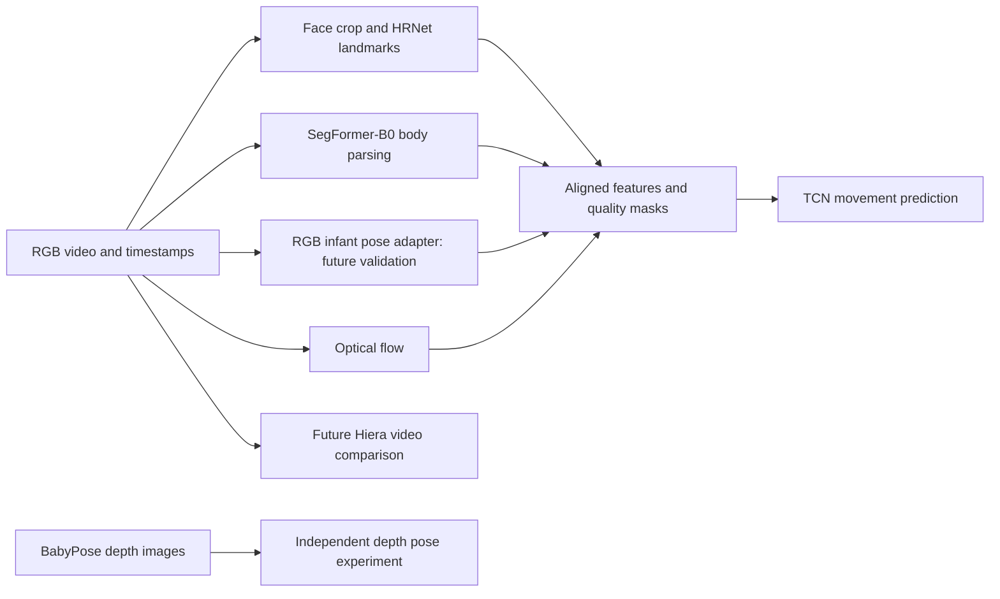

# Infant Movement Analysis Using Deep Learning

An independent, exploratory PyTorch research project for measuring infant facial geometry and body movement over time. The long-term question is whether validated movement measurements could support research into movements potentially associated with epileptic seizures.

**This is not a medical diagnostic system.** None of the candidate datasets is established here as providing clinically confirmed seizure events. Normative movement, neuromotor risk, facial expressiveness, and seizure status are different concepts; no conversion between these labels is permitted.

## Current status

**M1 metadata implementation completed on 27 October 2026**, within the user's authorization for package setup, minimal dependencies, and synthetic metadata/split checks. The package has no required core runtime dependencies; optional task environments are separate. At the start of the mean-shape comparison on 28 October, the checkout was clean at `39a2038` (completed training-only pilot), on `research/infanface-e0-audit`, matching the locally recorded `origin/research/infanface-e0-audit`; `origin` is `https://github.com/sadia2102/baby-movement-ai.git`. The user committed and pushed the prior milestone. The current comparison changes are local and uncommitted; this phase made no remote checks, uploads or pushes.

**InfAnFace acquisition/schema audit and the first independent annotation reader completed on 27 October 2026.** Only the official InfAnFace archive was acquired for authorized private noncommercial E0 inspection. There are no audited patient/video-independent project splits; identity and source-video mappings remain UNVERIFIED. The reader preserves official metadata and fractional coordinates without assigning project partitions.

**Image loading and landmark preprocessing completed on 28 October 2026.** The existing optional Pillow decoder now supports local ZIP image loading, explicit crops, uniform resize/padding, EXIF frame handling and forward/inverse coordinate transforms. No dependencies were added or changed. **209 synthetic tests passed.** A separate local smoke check processed 410/410 stored rasters; normalization processed 409/410 and explicitly rejected one invalid EXIF orientation tag. Source coordinate conventions and anatomical alignment remain **UNVERIFIED**. See the [preprocessing report](reports/infanface-preprocessing-2026-10-28.md) and [environment record](environments/infanface-preprocessing.md).

**Minimal landmark engineering baseline completed on 28 October 2026.** A separate `.venv-baseline` uses hash-locked PyTorch 2.14.1 and the existing Pillow/test pins. It adds a context-owned tensor adapter, a randomly initialized 75,832-parameter coordinate CNN, masked CPU training/validation, source-coordinate metrics, checkpoints and private run records. **248 synthetic tests passed.** On the fixed manufactured task, validation landmark error fell from **23.0058 to 0.2240 synthetic pixels**; checkpoint reload preserved all 16 validation predictions exactly. These are synthetic engineering results, not InfAnFace benchmark results. No real infant images entered model training or prediction during that synthetic milestone. See the [dated baseline report](reports/landmark-baseline-synthetic-2026-10-28.md) and [separate environment record](environments/landmark-baseline.md).

**First bounded InfAnFace real-data feasibility pilot completed on 28 October 2026.** One fresh CNN trained on **32 official training images**, using ground-truth-derived crops, for **20 CPU epochs / 80 updates**. Training-set mean error fell **22.6696 → 4.5561 pixels** in 32×32 inputs; all **2,176/2,176** target slots were geometrically eligible, with no exclusions. Fixed-final reload reproduced all 32 predictions exactly. **This is training-only fit, not held-out or benchmark accuracy**. No validation/project split was created, no test image was opened, and source conventions/subject-video independence remain **UNVERIFIED**. **288 synthetic tests pass.** See the [pre-execution protocol](reports/infanface-training-pilot-protocol-2026-10-28.md) and [actual pilot report](reports/infanface-training-pilot-2026-10-28.md).

**Constant-mean-shape control completed on 28 October 2026.** On the exact frozen 32-image training cohort, the CNN's input error was **4.5561 pixels** versus **4.8268** for a target-only constant mean: **0.2707 pixels / 5.61% lower**. CNN error was lower on **19/32** images and control error on **13/32**. All **2,176** points matched, with no missing-support exclusions. The fixed-final CNN reproduced its original metrics within the predeclared tolerance, with zero training updates. **310 synthetic tests pass.** This is same-cohort training fit; useful image-dependent learning and generalization remain unresolved. See the [control protocol](reports/infanface-mean-control-protocol-2026-10-28.md) and [aggregate comparison report](reports/infanface-mean-control-2026-10-28.md).

- [Detailed research plan](research_plan.md): dataset evidence, experiment protocols, metrics, leakage controls, dependency recommendations, hardware strategy, and weaknesses.
- [Contributor and agent rules](AGENTS.md): scope boundaries and reproducibility requirements.
- [InfAnFace acquisition and annotation audit](reports/infanface-e0-acquisition-audit-2026-10-27.md): receipt/hash, observed schema, quality findings, provenance limits, and 121-test verification.
- [InfAnFace duplicate/provenance audit](reports/infanface-duplicate-provenance-audit-2026-10-27.md): decoded pixels, near-duplicate candidates, local source evidence, limitations and 150-test verification.

The [InfAnFace desk review](reports/infanface-e0-desk-review-2026-10-27.md) and acquisition audit remain unchanged historical records. The subsequent local duplicate audit verified and preserved the archive, decoded all 410 samples, found no exact decoded-pixel groups, and investigated 23 candidate pairs. One pair has plausible shared-scene content; 22 match mainly through presentation/layout. None crosses the official train/test boundary, which does not establish subject/video independence. Two unparsed XMP blocks and missing authoritative source mappings remain UNVERIFIED. No identities, source-video IDs or project splits were created.

## Proposed research architecture



Facial landmarks describe geometry; expression recognition requires additional validated expression labels. Segmentation measures body regions and gates flow, while pose measures joints. These branches meet only when observations refer to the **same video and timestamps**. BabyPose depth supervision remains a separate experiment; it does not supply RGB labels.

## Independent experiments

| ID | Experiment | Supervision / output |
|---|---|---|
| E0 | Provenance, annotation, and split audit | Dataset-specific manifests and leakage report |
| E1 | HRNet facial landmark adaptation | InfAnFace landmarks; normalized localization errors |
| E2 | SegFormer-B0 body parsing | YouTube Infant Body Parsing masks; region overlap |
| E3 | Infant depth-pose adaptation | BabyPose joints; 2D localization errors |
| E4 | Movement features and causal TCN | Chambers pose sequences; nonclinical forecasting |
| E5 | Modular video integration | Synchronized permitted RGB videos; quality and robustness |
| E6 | Deferred Hiera video comparison | Same eligible forecasting target and held-out groups |

These datasets must never be concatenated into a single supervised dataset. E1–E4 have separate adapters, label schemas, configurations, checkpoints, and reports. E5/E6 are conditional on access and validated inputs.

## Repository layout

```text
README.md / AGENTS.md / research_plan.md
pyproject.toml    # Installable package, development tools, lint/test configuration
configs/
  datasets/       # One schema and configuration per dataset
  models/         # Architecture, source revision, checkpoint identity
  experiments/    # E0–E6 resolved protocols, created after review
  environments/   # CPU / Apple MPS / optional later CUDA overrides
src/infant_movement/
  datasets/       # Metadata envelope and independent InfAnFace annotation reader
  models/         # Face, segmentation, depth pose, RGB pose, TCN adapters
  features/       # Geometry, flow, timestamps, missingness
  engine/         # Training, checkpointing, inference, device selection
  evaluation/     # Grouped checks, whole-image candidates and local XMP references
  utils/          # Config, seeding, provenance, hashing
scripts/          # Explicit local audits, synthetic verification and bounded pilot entry points
tests/            # Synthetic metadata, reader, image, provenance and CLI checks
manifests/        # Private actual sample, identity, and split records
data/{raw,interim,processed}/  # Local ignored assets, kept separate by dataset
artifacts/{checkpoints,features}/  # Local ignored derived artifacts
reports/          # Shareable aggregate reports after disclosure review
notebooks/        # Exploration using package code, not training logic
environments/     # Tested M1 development lock and environment/verification record
```

The original folder structure and `research_plan.md` are preserved. The plan records the original proposals and 18 October evidence snapshot; README and dated reports record implementation status. InfAnFace supervision stays separate from other datasets. The core package has no required runtime dependencies; image decoding uses only the optional hash-locked Pillow extra.

## Development environment

Verified for M1: **CPython 3.13.3, macOS 27.0.1, arm64**, with the exact tools in [the development lock](environments/macos-arm64-py313-dev.lock). See [the environment and verification record](environments/m1-environment.md). Python 3.11 remains the plan's proposed future training baseline; it was not installed for this standard-library-only milestone. Other Python versions, operating systems, and training/accelerator compatibility have not been verified. `requires-python >=3.11` is the code's intended minimum, not a tested compatibility matrix.

The existing `.venv` now also contains Pillow 13.0.0 for the bounded image audit. See [the optional decoder environment record](environments/infanface-image-audit.md) and [combined image-audit lock](environments/macos-arm64-py313-image-audit.lock). Historical M1 pins remain unchanged.

From the repository root, the existing environment is ready to use without activation:

```sh
.venv/bin/python -m pytest -q
.venv/bin/python -m ruff check .
.venv/bin/python -m ruff format --check .
.venv/bin/python -m pip --disable-pip-version-check --no-cache-dir check
.venv/bin/infant-movement audit tests/fixtures/synthetic_metadata.json
```

For a fresh checkout on the same platform with Python 3.13.3 already available, create the environment and install the hash-locked tools. The first installation command explicitly accesses the Python package index for packaging/testing tools only. It downloads wheels; it does not acquire research assets. The editable project installation then runs with network resolution disabled:

```sh
python3.13 -m venv .venv
.venv/bin/python -m pip --disable-pip-version-check --no-cache-dir install --only-binary=:all: --require-hashes -r environments/macos-arm64-py313-dev.lock
.venv/bin/python -m pip --disable-pip-version-check --no-cache-dir install --no-index --no-build-isolation --no-deps -e .
```

The lock includes pip, setuptools, wheel, pytest, Ruff, and all their installed dependencies. `pyproject.toml` also declares a pinned `dev` extra; use the lock above for the verified preprocessing environment. Avoid installing an unpinned tool midway through a milestone. The optional image-audit extra adds only Pillow and also supports preprocessing. The original `.venv` now runs **250 tests with four optional Torch test modules skipped**; the complete baseline suite requires `.venv-baseline` below. Imports, audits, tests, and lint checks make no network requests. For offline recreation, obtain the locked wheels explicitly on an authorized connection, then add `--no-index --find-links /path/to/wheels` to the locked-tools install command. Hash checking follows [pip's documented installation mode](https://pip.pypa.io/en/stable/topics/secure-installs/); package configuration follows the [PyPA guide](https://packaging.python.org/en/latest/guides/writing-pyproject-toml/).

To verify a distributable wheel locally, after the checks above:

```sh
.venv/bin/python -m pip --disable-pip-version-check --no-cache-dir wheel --no-index --no-build-isolation --no-deps --wheel-dir dist .
```

`dist/`, `.venv/`, caches, and generated package metadata are ignored by Git. No license has been assigned to this project's code; dataset, original-media, and pretrained-weight permissions remain separate.

## InfAnFace local annotation reader

`infant_movement.datasets.infanface` provides `load_infanface_archive(path)` and `load_infanface_csv(path)`. Both read explicit local files and return immutable dataset-native samples. They perform no downloads, archive extraction, image decoding, split generation, or model inference.

The observed CSV contains 144 columns: four image/partition references, four binary attributes, and 68 `(x,y)` pairs. The reader checks finite coordinates, schema, reference safety, uniqueness, and official partition/attribute consistency. It preserves fractional and out-of-bounds source values. `landmark_bounds_mask(sample, width, height)` supplies a separate geometric QC mask; this is not a visibility annotation. The source pixel indexing origin remains UNVERIFIED.

For an aggregate local check of the already acquired archive:

```sh
.venv/bin/python - <<'PY'
from collections import Counter
from infant_movement.datasets.infanface import load_infanface_archive
samples = load_infanface_archive("data/raw/infanface/InfAnFace.zip")
print(len(samples), dict(Counter(s.official_split for s in samples)))
PY
```

Expected for the recorded receipt: 410 rows, with 210 `infanface-train` and 200 `infanface-test`. The archive SHA-256 and private evidence locations are recorded in the [acquisition audit](reports/infanface-e0-acquisition-audit-2026-10-27.md). An independent publisher checksum remains UNVERIFIED.

No subject/source-video IDs or project partitions are assigned. The private `manifests/infanface-unassigned-inventory-2026-10-27.json` intentionally does **not** satisfy the M1 split schema: unknown source groups and unassigned project partitions must not be fabricated to make an audit pass. Do not feed that inventory to the `audit` CLI as a claimed clean split. Every other dataset's supervision remains separate.

## Local duplicate and provenance audit

The completed [dated report](reports/infanface-duplicate-provenance-audit-2026-10-27.md) documents the fixed method and all aggregate findings. Exact equality uses dimensions plus decoded RGBA8 pixels, both stored and EXIF-oriented. Near-candidate screening uses whole-image dHash ≤6 **and** aHash ≤8 on the same view combination, testing full/central-80% views and mirrors. No face recognition, embeddings or infant identity assignment is used. Similarity is a review request, not duplicate/source confirmation.

All 83,845 pairs were compared. There were zero exact-pixel groups and 23 candidates, all within official training. All candidates were investigated; one remains a plausible shared-scene pair, while 22 are primarily layout/presentation matches. Source review found no confirmed video mapping; two XMP blocks remain unparsed/UNVERIFIED. These findings do not certify patient/video independence or justify a new independent split.

To recreate the optional decoder environment on this platform, explicitly install the hash-locked wheels and refresh the local editable package without dependency resolution:

```sh
.venv/bin/python -m pip --disable-pip-version-check --no-cache-dir install --only-binary=:all: --require-hashes -r environments/macos-arm64-py313-image-audit.lock
.venv/bin/python -m pip --disable-pip-version-check --no-cache-dir install --no-index --no-build-isolation --no-deps -e .
```

From the repository root, choose **new, unused** private output names:

```sh
.venv/bin/python -m infant_movement duplicate-audit --archive data/raw/infanface/InfAnFace.zip --receipt data/raw/infanface/acquisition-receipt-2026-10-27.json --output reports/private/infanface-duplicates-rerun.json
.venv/bin/python scripts/audit_infanface_sources.py --archive data/raw/infanface/InfAnFace.zip --audit-report reports/private/infanface-duplicates-rerun.json --output reports/private/infanface-sources-rerun.json
```

These commands read local files, verify archive integrity before/after, print aggregates and write per-sample evidence only under `reports/private`. They refuse overwriting and make no network requests or project assignments. Source-audit completion does not imply every XMP block parsed; inspect `xml_failure_count`. Original private audit JSON, contact sheets and review decisions remain Git ignored. Do not publish per-sample hashes, metadata or candidate edges. No images or data-dependent fixtures are embedded in tests.

## InfAnFace image loading and landmark preprocessing

`datasets.infanface_images.open_infanface_images(path, expected_sha256=...)` reads validated samples and exact JPEG/PNG ZIP members without extraction. It verifies the receipt digest before and after the context, rejects duplicate/missing/encrypted/oversized/symlink image members, and bounds decoded pixels. Loaded images are owned RGB rasters in stored orientation; transparency is composited over white. New rasters carry no original EXIF/XMP metadata. Raw files and the immutable annotation objects are preserved. Close loaded/prepared Pillow images after use; each loaded image remains usable after its archive context closes.

`preprocess_face` requires explicit `source_index_base`, `annotation_frame`, `orientation_policy`, `crop_box` and `output_size`. The output retains the original sample, transformed landmarks, 3×3 `forward.matrix` and `inverse.matrix`, crop/configuration details and separate `present`, `source_in_bounds`, `crop_in_bounds` and `output_in_bounds` flags. Out-of-bounds values are transformed without clipping; explicit `None` remains missing. The native annotation reader still rejects missing/nonfinite CSV values; it does not fabricate them. Geometric flags are not per-landmark visibility, occlusion, confidence or a preselected loss mask. A point outside the crop may map into output padding, so `output_in_bounds` alone is insufficient for supervision.

**Working convention:** pixel edges span `[0,width] × [0,height]`, with centres at `(column+0.5,row+0.5)`. Raster footprint flags are half-open `[0,width) × [0,height)`. Base 0 hypothesizes that raw `(0,0)` means the first pixel centre; base 1 hypothesizes raw `(1,1)`. Conversion adds `0.5 - source_index_base` to both axes. This is a caller-declared hypothesis, **not verification of the source indexing convention**. The older annotation reader's `[0,width) × [0,height)` numeric QC remains unchanged and is a different declared check.

`annotation_frame="stored"` declares raw coordinates relative to stored pixels; `"display"` declares them relative to the EXIF display raster. `orientation_policy="stored"` leaves pixels as stored; `"normalize"` applies EXIF to pixels and coordinates consistently. All eight standard orientations are supported. Invalid tags fail any requested normalization/frame conversion; an absent tag uses the identity operation without claiming verified upright content. EXIF mirrors preserve the vertex identity map **`i → i` for every index 0–67**. These are raster metadata corrections. No anatomical horizontal-flip augmentation is implemented; that requires an independently verified landmark swap map. Output metadata is cleared to prevent a second implicit EXIF rotation.

Crop boxes are integer half-open `(left,top,right,bottom)` edges **in the selected processing raster**, entirely inside it. `crop_box=None` explicitly selects the whole raster. The generic preprocessing API does not infer a crop. The separate pilot explicitly derives **ground-truth crops** from annotations as described below; no face detector or random augmentation is implemented. Ground-truth-crop fit is separate from detector-backed coverage/performance.

The cropped image is fitted with one scale `s=min(output_width/crop_width, output_height/crop_height)` and continuous centred padding. BICUBIC inverse-affine resampling avoids independent dimension rounding and preserves aspect ratio exactly. Padding is black by default; alpha compositing uses white independently. No learned normalization, tensor conversion, heatmaps or model-specific preprocessing is implied. BICUBIC affine downsampling has no separate scale-aware antialias prefilter and is not claimed to match an upstream HRNet recipe. Future integer-centre predictions must be converted to edge coordinates (add 0.5) before applying `inverse`; heatmap stride/normalization must be specified separately.

Example from the repository root, using the existing `.venv` and **explicit unverified hypotheses**, with no saved image or sample-level output:

```sh
.venv/bin/python - <<'PY'
import json
from pathlib import Path
from infant_movement.datasets.infanface_images import preprocess_face
from infant_movement.datasets.infanface_pilot import open_training_images
from infant_movement.datasets.landmark_geometry import transform_landmarks

digest = json.loads(Path("data/raw/infanface/acquisition-receipt-2026-10-27.json").read_text())["sha256"]
with open_training_images("data/raw/infanface/InfAnFace.zip", expected_sha256=digest) as images:
    face = images.load(images.samples[0])
    try:
        result = preprocess_face(
            face, source_index_base=0, annotation_frame="stored",
            orientation_policy="stored", crop_box=None, output_size=(256, 256),
        )
        try:
            recovered = transform_landmarks(result.landmarks, result.inverse)
            assert all(abs(a-b) < 1e-8 for p,q in zip(face.sample.landmarks, recovered) for a,b in zip(p,q))
            print("one local image checked; source assumptions remain UNVERIFIED")
        finally:
            result.image.close()
    finally:
        face.image.close()
PY
```

**Historical full-raster smoke commands from the preprocessing milestone; do not run while the official test partition is sealed.** They read all official images. Use the training-only pilot entry point for the current scope. These smoke checks write only aggregate records under `reports/private`. Choose **unused** output filenames; overwriting is refused. These fixed full-raster checks use all official images only for loading/geometry QC, never to fit preprocessing or select model settings:

```sh
.venv/bin/python scripts/smoke_infanface_preprocessing.py --archive data/raw/infanface/InfAnFace.zip --receipt data/raw/infanface/acquisition-receipt-2026-10-27.json --source-index-base 0 --annotation-frame stored --orientation-policy stored --output-size 256 256 --output reports/private/infanface-preprocessing-stored-rerun.json
.venv/bin/python scripts/smoke_infanface_preprocessing.py --archive data/raw/infanface/InfAnFace.zip --receipt data/raw/infanface/acquisition-receipt-2026-10-27.json --source-index-base 0 --annotation-frame stored --orientation-policy normalize --output-size 256 256 --output reports/private/infanface-preprocessing-normalize-rerun.json
```

`--crop-box LEFT TOP RIGHT BOTTOM` optionally supplies one explicit box, in the chosen frame, for every checked image; a single box need not fit all images. The smoke command returns 0 for complete coverage/round trips, 1 for decode/preprocessing rejections, annotation changes or excessive round-trip error, and 2 for invalid invocation/input/output. The completed stored check returned **0: 410 decoded/processed**, zero annotation changes and **one retained source-out-of-bounds landmark**. Normalization returned **1: 410 decoded, 409 processed, one invalid EXIF tag `0` rejected**. Maximum round-trip error in each run was **6.821210263296962e-13 source pixels**. Reversible arithmetic cannot establish that the chosen source origin/frame aligns landmarks anatomically. Official membership stays 210 training/200 test; identities, source groups and project partitions remain untouched.

## Minimal landmark baseline: synthetic CPU verification only

The [baseline environment lock](environments/macos-arm64-py313-baseline.lock) pins all 19 selected native/tool wheels with verified SHA-256 hashes. The existing `.venv`, preprocessing code and historical locks are preserved. `.venv-baseline` uses the same available CPython 3.13.3 interpreter without changing system Python. PyTorch 2.14.1 is the only new direct model dependency; Pillow 13.0.0 and the development/build pins are reused. No torchvision, NumPy, pretrained weights, CUDA-only dependency, tracking service or training framework was added. A first-import PyTorch warning notes that its optional NumPy bridge is unavailable; this implementation uses no NumPy bridge and all checks pass. See [tested versions and reproduction instructions](environments/landmark-baseline.md).

The input adapter in `datasets/torch_landmarks.py` wraps an existing `open_infanface_images` context. It requires an explicit official partition and `LandmarkInputConfig` (origin hypothesis, annotation frame, EXIF policy, crop and output size). Use `num_workers=0` and finish iteration before the archive context closes. It creates no project split or identity. Image tensors are contiguous RGB **CHW float32 in `[0,1]`**, without fitted/ImageNet normalization. Targets retain source index order as **68 `(x/W,y/H)` pixel-edge pairs**. Out-of-bounds numbers remain present; missing points remain NaN with a false mask. Loss eligibility is `present AND source_in_bounds AND crop_in_bounds AND output_in_bounds`; the separate masks, raw coordinates, forward/inverse matrices, official membership and explicit coordinate/EXIF assumptions are retained. Geometric eligibility is not landmark visibility. The adapter was initially verified with manufactured archives. The separate training-only pilot now reuses its tensor/geometry contract on 32 authorized real training examples; it does not change this generic adapter’s partition API.

`models/landmark_baseline.py` implements `SmallLandmarkCNN`: two small strided convolutions, a spatially retained flattened representation and a two-layer coordinate head. Its input is **B×3×32×32**, and its unconstrained linear output is **B×68×2** normalized edge coordinates. No weights are loaded or downloaded. `decode_coordinates` multiplies by `(width,height)` and applies the recorded inverse in float64 to return original annotation numbers; it adds no extra half pixel and does not clamp predictions. This engineering baseline precedes the proposed HRNet experiment; the research plan is unchanged. Low resolution, direct regression and simplified synthetic geometry limit what it can establish about infant localization.

`engine/landmark_baseline.py` provides ordinary Adam training and validation with explicit `TrainConfig`. Masked MSE averages eligible x/y scalars after selecting the mask, so excluded NaNs do not poison gradients. An entirely missing-target batch returns no loss and takes no optimizer step. An empty loader, an entirely unsupervised training/validation epoch, nonfinite predictions or nonfinite eligible targets fail explicitly. The runnable command accepts only a manufactured-data configuration and a new ignored run directory; it has **no real-data/archive option**. CPU, one thread, deterministic algorithms, seeded generators, no worker processes and no implicit downloads are used.

Metrics are independently implemented in standard Python in `evaluation/landmark_metrics.py`. Primary error is Euclidean distance in **source pixel units**, averaged over eligible landmarks per image and then over eligible images equally. This is image-macro aggregation, not patient/source-group aggregation. Coverage reports eligible point slots and images. Normalized error requires an explicit positive finite denominator per image; missing/zero/invalid denominators yield undefined normalized error and counted coverage, with **no fallback**. `interpoint_normalizers` requires a caller-declared index pair; no eye indices or benchmark NME convention are assumed. All indices 0–67, or an explicit subset, are supported as source array slots. Their anatomical interpretation and the official interocular definition remain **UNVERIFIED**. Synthetic results below report unnormalized pixel error only.

From the repository root, run the complete offline checks using the already installed baseline environment:

```sh
.venv-baseline/bin/python -m pytest -q
.venv-baseline/bin/python -m ruff check .
.venv-baseline/bin/python -m ruff format --check .
.venv-baseline/bin/python -m pip --disable-pip-version-check --no-cache-dir check
.venv-baseline/bin/infant-movement audit tests/fixtures/synthetic_metadata.json
```

To repeat the bounded CPU experiment, choose an **unused** directory below `runs/`:

```sh
.venv-baseline/bin/python scripts/verify_synthetic_baseline.py --config configs/experiments/synthetic_landmark_baseline.json --run-dir runs/synthetic-landmark-baseline-rerun
```

The fixed task manufactures 32 training and 16 validation 32×32 images showing moving Gaussian vertical/horizontal stripes. The intersection translates a fixed 68-point ellipse. All targets are synthetic and valid; this is not facial anatomy or seizure supervision. The config fixes seed 42, batch 8, Adam LR 0.003 and 120 epochs (**480 optimizer steps**); the runner caps configurable epochs at 200 and sample counts at 64. Validation seed is 43 and training-loader seed 44. The predeclared acceptance rule is validation mean pixel error `<1` and `<10%` of initial, plus exact checkpoint reload. The selected checkpoint minimized synthetic validation normalized-coordinate MSE at epoch **119**. Source-pixel error changed **23.00578460050085 → 0.22398287668670216**, normalized MSE **0.2676038146018982 → 0.000034110201340809**, with 16/16 images and 1,088/1,088 points eligible. All 16 reloaded validation predictions matched exactly (maximum difference 0). No independent synthetic test set or real-data accuracy is claimed.

The new run directory holds resolved config, source/data/lock hashes, Git head/dirty-state records, seeds/device/environment, epoch losses/coverage, best/last model and optimizer state dictionaries, Python/Torch/loader RNG states, checkpoint digest, summary and status. `load_checkpoint(..., expected_sha256=...)` checks the digest and uses CPU `weights_only=True`; use only locally generated checkpoints. Restoring model/optimizer and optional RNG is supported; exact interrupted-training resume is not claimed. Existing run directories are never overwritten. The completed final record is `runs/synthetic-landmark-baseline-2026-10-28-verified/`; all run files/checkpoints are Git ignored. The first fixed-config run was retained, and a repetition after expanding reload verification to all validation examples reproduced the same metrics/checkpoint digest without changing training settings.

The private coordinate review inspected **eight official training examples only**: first two in each training batch plus two additional examples with known EXIF rotations from existing audit metadata. Stored-raster overlays grossly aligned in those eight; assuming already-display-frame annotations visibly misaligned the two rotated examples. This is tentative evidence for those examples, not verified global conventions. A one-pixel origin difference could not be adjudicated. Source indexing and frame remain **UNVERIFIED**, and the review used no model predictions or identity inference. For EXIF tag `0`, stored/stored processing preserves the raster; normalization/frame conversion rejects it with no automatic override. The existing out-of-bounds annotation remains unchanged and numerically retained, with false eligibility under the declared footprint check. That prior test-partition finding was not visually re-inspected. Neither case has been silently removed or rewritten.

## Metadata and grouped split audit

The implemented command reads a **local JSON metadata file only**, validates it, and checks already assigned project partitions. It neither generates splits nor reads images, checks actual annotation payloads, changes input files, or assigns clinical labels. Run it **before** frame extraction, windows, augmentation, learned preprocessing, or pseudo-labeling. Audit each CV fold/protocol separately; a manifest has exactly one row per `(dataset_id, release_id, sample_id)`.

Use [the entirely synthetic example](tests/fixtures/synthetic_metadata.json) as the format reference:

```json
{
  "schema_version": 1,
  "records": [
    {
      "dataset_id": "synthetic",
      "release_id": "v1",
      "sample_id": "sample-001",
      "source_group_id": "source-001",
      "project_split": "train",
      "identity_status": "unknown",
      "subject_id": null,
      "source_video_id": "video-001"
    }
  ]
}
```

| Field | M1 validation rule |
|---|---|
| `dataset_id`, `release_id`, `sample_id` | Required pseudonymous identifiers; the tuple uniquely identifies one row |
| `source_group_id` | Required conservative source/provenance group, including still images; a proxy does not establish infant identity |
| `project_split` | Required, exactly `train`, `validation`, or `test`; partial manifests are permitted and counts include absent partitions |
| `identity_status` | Required, exactly `known` or `unknown` |
| `subject_id`, `identity_evidence` | Nullable; `known` requires both a shared subject key and a private evidence-reference key; `unknown` requires `subject_id=null` |
| `source_video_id` | Nullable for still images/unresolved sources; when known, all derivatives inherit the same canonical registry key |
| `duplicate_group_id` | Nullable key linking known exact/near duplicates and reuploads, including different video IDs |
| `session_id` | Optional nullable reference metadata; it is not a substitute for source/subject grouping |
| `official_split` | Optional nullable original split name; retained exactly, never used to overwrite project assignments |
| `frame_index` | Optional nonnegative integer; booleans/fractions rejected |
| `timestamp_seconds` | Optional finite nonnegative number; neither timing nor a frame rate is inferred |

Identifiers use 1–128 ASCII letters/digits plus `_`, `.`, `:`, `-`, starting with a letter/digit. Empty strings, whitespace, URLs, and placeholder strings such as `unknown` or `UNVERIFIED` are rejected as identifiers. `official_split` is a nonempty original name and may contain spaces or punctuation. Use JSON `null` for missing optional values; required unknown provenance must be resolved or excluded before this audit can pass. Omitted optional fields become `null`, never a negative label or zero measurement. Frame/time fields require a source-video key. Unsupported fields, duplicate JSON keys, nonfinite numbers, invalid identity combinations, empty manifests, and unsupported schema versions fail validation. This schema checks single-row timestamp validity; sequence ordering and timestamp/media alignment remain unimplemented.

`subject_id`, `source_video_id`, `source_group_id`, and `duplicate_group_id` are **global keys from a common private registry**, with a separate namespace for each field. Do not prefix a shared video's key with a dataset name or change it between releases. Resolve dataset-local aliases and known reuploads in that private registry first. For unrelated local IDs, assign distinct pseudonymous registry keys. The grouped-key checker performs no facial identification or duplicate discovery; the separate optional whole-image audit generates candidates for evidence review, never infant identities. A registry can include metadata references across collections to detect overlap; their labels and training datasets remain separate.

Each supplied subject, source video, source group, and duplicate group must occur in at most one project partition. Checking every relationship also catches a connected group crossing partitions: at least one shared-key relationship must cross the boundary. Repeated sample keys fail even within one partition; multiple frames from one source inside a partition are valid. Null subjects/videos are skipped and counted as limitations. A clean result does **not** establish patient independence, rights clearance, absence of unidentified duplicates, or upstream-training disjointness.

To audit an eventual approved private manifest:

```sh
mkdir -p reports/private
.venv/bin/infant-movement audit manifests/private-metadata.json > reports/private/split-audit.json
```

The input above is a future private file, not a provided dataset. `python -m infant_movement audit ...` is equivalent when using the environment's Python. Exit codes are **0** for valid metadata with no known group overlap (warnings may remain), **1** for repeated samples or group leakage, and **2** for invalid/unreadable input or command usage. JSON output includes counts, warning/limitation text, and one-based record rows for conflicts. It omits registry IDs. Actual manifests, identity evidence/maps, and audit reports must remain private; the ignore rules cover `manifests/` and `reports/private/`.

## First real InfAnFace pilot: training-only ground-truth crops

The [fixed protocol](reports/infanface-training-pilot-protocol-2026-10-28.md), [configuration](configs/experiments/infanface_train_pilot.json) and [dated results/limitations](reports/infanface-training-pilot-2026-10-28.md) define the single completed pilot. It ranked the **210 official training references** by SHA-256 of `infanface-train-fit-v1|42|<image-set>/<filename>`, then selected the first **32**, with no replacement sampling. The training-only reader discards test rows before numeric payload parsing and rejects test/non-training image requests. It reads the shared labels index and hashes the compressed archive for integrity, without opening test-image members. Unknown identity/video/source-group/project fields stay unknown; no validation or new split was fabricated.

The explicit working hypothesis is **base-0 source pixel centres in the stored raster**, converted to edge coordinates by +0.5. Source origin/global annotation frame remain **UNVERIFIED**. Existing eight training-only overlays and this pilot's private review of all 32 selected annotation panels support gross correspondence only; this is a single qualitative assistant review, not independent anatomical adjudication. Do not interpret geometric eligibility as visibility or per-point accuracy.

The pilot derives a box from at least three finite in-footprint points with nonzero axis spans, expands each side by 20% of its corresponding span, floors/ceils edges and clips only the box. It uses the existing reversible BICUBIC aspect-preserving affine fit to **32×32 with black padding**, RGB CHW float32 `[0,1]`, no augmentation, and normalized edge targets. All raw annotations/transforms/masks are retained. These **ground-truth/oracle crops use target geometry**; detector performance was not measured. Stored/stored orientation never rotates pixels alone, including tag 0; requested normalization of invalid EXIF still fails. This selection had 29 absent tags, two tag 1 and one tag 6, with zero invalid tags. The historical invalid-tag and test out-of-bounds findings were not sought or reopened. Out-of-bounds values would remain numerical and masked, missing slots NaN plus a false mask, with no clamping or inferred visibility.

The unchanged small CNN used fresh seed **42**, shuffle seed **43**, CPU float32/one thread/zero workers, Adam LR **0.003**, batch **8**, exactly **20 epochs / 80 updates**. No pretrained/synthetic checkpoint initialization, sweep, validation or best-epoch selection. Initial/final evaluation used exactly the same 32 training images. Only the fixed final checkpoint was saved.

| Training-only result | Initial | Fixed final epoch 20 |
|---|---:|---:|
| Normalized coordinate MSE | 0.27231643 | 0.01366299 |
| Image-macro input-pixel Euclidean error (32×32) | 22.6696 | 4.5561 |
| Image-macro source-pixel Euclidean error | 415.9650 | 82.9871 |

All **32/32 selected images** decoded and were usable, with **2,176/2,176** points eligible and zero exclusions/mask failures. Only those 32 training images were decoded; this is not full-pool or visibility coverage. Errors average eligible landmark distances within an image, then give each image equal weight, across all 68 source slots. Source-pixel error depends on original resolution/crop scale. No supported anatomical eye denominator was available: **NME remains undefined**, with 32 undefined-denominator images. Reload preserved all 32 predictions exactly (maximum difference 0). Training fit does not establish image-dependent learning, held-out, patient/video-independent, benchmark or clinical accuracy.

The existing `.venv-baseline` and its historical hash lock were reused without any dependency changes: CPython **3.13.3**, Torch **2.14.1**, Pillow **13.0.0**, macOS **27.0.1 arm64**. The optional NumPy-bridge warning remains harmless to the tested path; no NumPy bridge is used. Software verification passed **before** the real run: **288 synthetic tests**, lint, formatting of **39 Python files**, both environments’ dependency checks, exact baseline inventory against all **19 pinned distributions**, and the synthetic metadata audit. The preserved `.venv` passes **250 tests, two optional Torch modules skipped**. The 40 added synthetic cases cover deny-first test access, deterministic selection, crop/mask arithmetic, tag-0 preservation, review/hash gates, fixed-final reload and rerun refusal. Infant data is not required by any test.

From the project root, these are the **exact executed commands**, in order. The completed paths refuse overwrite/re-execution. They document this run; **do not start another real run under this milestone**:

```sh
.venv-baseline/bin/python scripts/verify_infanface_pilot_checks.py --output reports/private/infanface-pilot-software-verification-2026-10-28.json
.venv-baseline/bin/python scripts/run_infanface_pilot.py prepare --config configs/experiments/infanface_train_pilot.json --archive data/raw/infanface/InfAnFace.zip --receipt data/raw/infanface/acquisition-receipt-2026-10-27.json --protocol reports/infanface-training-pilot-protocol-2026-10-28.md --run-dir runs/infanface-train-pilot-2026-10-28
# Actual annotation-only review of both private QC pages occurred here.
# Create alignment-review.json from its private template only after reviewing
# every usable image; preserve hashes and UNVERIFIED conventions, record
# reviewer, reviewed count, evidence and limitations. Never auto-approve it.
.venv-baseline/bin/python scripts/run_infanface_pilot.py run --run-dir runs/infanface-train-pilot-2026-10-28 --checks reports/private/infanface-pilot-software-verification-2026-10-28.json
```

The software gate runs the full baseline pytest/lint/format/dependency checks, original-environment pytest/dependency checks, and synthetic metadata audit, recording command outputs privately. Use the general verification commands above for ordinary development. After future code changes, a new unused private verification output is required; source/config/protocol mismatches block execution. For a separately authorized reproduction, choose a fresh ignored run directory and perform a new actual alignment review; existing completion/failure state must not be deleted to bypass the single-run gate. A failure records status and stops, with no automatic rerun.

The ignored run retains configuration, private selected references/boxes/annotation and selection hashes, coverage, QC/review, Git state/code/lock/archive/protocol hashes, exact environment, seeds, per-epoch losses, initial/final training metrics, `final.pt` with digest and exact reload result, and completion status. No private record, image, overlay, weight or run output is tracked by Git. The archive, original inventory, original plan, prior reports/environment locks/private evidence and previous run artifacts retain their pre-milestone hashes. No uploads, pushes, extra dataset/weight downloads, contacts, PRs or background jobs occurred.

The pilot stopped at that milestone; its separately authorized constant-mean-shape control is now completed below. Before held-out research: independently adjudicate coordinate/frame evidence, verify anatomical metric conventions, resolve or explicitly limit subject/source grouping, freeze defensible validation/model-selection rules, and review intended learned-weight/media rights. Official test images remain sealed. Low resolution, direct regression, oracle-crop leakage, no detector/visibility labels and unknown provenance remain substantial limitations.

## Constant-mean-shape control on the frozen training cohort

The [pre-results protocol](reports/infanface-mean-control-protocol-2026-10-28.md), [fixed configuration](configs/experiments/infanface_mean_control.json) and [dated report](reports/infanface-mean-control-2026-10-28.md) describe one completed comparison with no retraining, new samples, altered crops, checkpoint selection or test-image access. It verifies recorded hashes, joins only the original ordered usable references, and reconstructs the same annotations, explicit boxes, geometric masks, preprocessing and inverses. All 15 original run files and 105 pre-milestone historical files remain unchanged. Original source conventions remain **UNVERIFIED**, and official partitions/unknown identities stay untouched.

`models/mean_shape.py` fits a **float64 masked arithmetic mean per landmark** of the original normalized float32 targets, then predicts that same shape on every image. Its API accepts targets/masks and a prediction count, with **no image-content input**. Fit and evaluation use the same training cohort. The mean minimizes point-weighted normalized-coordinate MSE among constant predictors, not necessarily Euclidean or image-macro error. A landmark with no eligible observations stays NaN/null plus support 0; no fabricated zero. Matching uses original eligibility intersected with supported control slots, and nonfinite eligible CNN predictions fail rather than disappear. Here all 68 slots have support 32: both methods use **32 images, 2,176/2,176 matched points and 4,352 coordinate scalars**, with zero exclusions or zero-support slots. Geometric validity is not visibility.

| Same-training-cohort metric | Constant control | Fixed-final CNN | CNN relative reduction |
|---|---:|---:|---:|
| Normalized-coordinate MSE (float64 evaluation) | 0.01549707 | 0.01366299 | 11.8350% |
| Image-macro 32×32 input-pixel Euclidean error | 4.8268 | 4.5561 | 5.6084% |
| Image-macro source-pixel Euclidean error | 87.2972 | 82.9871 | 4.9373% |

The CNN is better on aggregate, by **0.2707077 input pixels** and **4.3100874 source pixels**. Per-image input/source Euclidean error favors CNN on **19 images**, control on **13**, no ties. Mean/median signed input differences (CNN − control) are **−0.2707077 / −0.1674552**, ranging **−1.8954353 to +1.1863556** pixels. MSE favors CNN on 18 images and control on 14. Detailed paired aggregates are in the report; sample-level values stay private. There are no patient-independence statistics, p-values or confidence intervals. Relative reduction `(control-CNN)/control` is undefined/null when the control denominator is exactly zero; none were zero here. Anatomical NME is undefined for both methods, with no invented eye denominator.

The verified epoch-20 checkpoint was loaded for CPU evaluation only, with original order/batch 8/one thread/zero workers. The original evaluator reproduces its prior aggregates exactly. Independently accumulated float64 CNN MSE differs from the original float32 loss by only **2.8933e-10**; both checks pass the predeclared MSE `atol=1e-7`, pixel-error `atol=1e-6`, `rtol=1e-6` rule. No threshold was widened, checkpoint changed or metric silently substituted. The modest gain over a strong constant crop-relative shape does not establish useful image-dependent learning, held-out accuracy, detector performance or clinical usefulness.

Before result calculation: **310 synthetic tests passed**, lint and formatting (**45 Python files**), dependency checks in both environments, all **19** existing baseline lock pins and synthetic metadata audit passed. The preserved `.venv` passes **250 tests, four expected optional Torch-module skips**. The 22 new checks include unequal validity masks/hand arithmetic, unsupported landmarks, source inversion, zero relative denominators, paired summaries, changed/unauthorized input rejection, no optimizer/backward operations, immutable originals and reproduction discrepancy retention. No dependencies were added or changed.

One initial attempt failed at **environment preflight before loading images or calculating results**: `pip freeze` recorded the user's new editable-project commit `39a2038` instead of `a2c682e`, while all dependency pins and original source hashes matched. The failed directory/records remain preserved. The protocol documents the correction before any results: permit only that same editable project's Git revision field to differ, with every other inventory line and historical source/lock hashes still checked. New tests reject actual dependency/repository/additional-package changes. After the corrected full gate, the single result calculation completed in a fresh directory; there was no extra training run, measured ablation or reproduction discrepancy.

Exact final commands executed from the project root:

```sh
.venv-baseline/bin/python scripts/verify_infanface_pilot_checks.py --output reports/private/infanface-mean-control-software-verification-2026-10-28-final.json
.venv-baseline/bin/python scripts/run_infanface_mean_control.py --config configs/experiments/infanface_mean_control.json --run-dir runs/infanface-mean-control-2026-10-28-verified --checks reports/private/infanface-mean-control-software-verification-2026-10-28-final.json
```

These are records of the completed comparison, **not authorization for another calculation**. The command requires an unused directory, passing current-code software checks, a fixed configuration, a completed unchanged original pilot and supported CNN reproduction. It refuses changed/unauthorized references and original/public output destinations. Do not delete the failed/completed status or loosen thresholds to rerun it. Ordinary development uses the general offline verification commands above.

Private ignored comparison outputs include control configuration, frozen references/checkpoint hashes, code/protocol/lock/environment/Git evidence, environment-comparison details, reproduction checks, learned mean/support, targets/masks/inverses and predictions, sample-level paired differences, aggregate summary, output hashes and completion status. The original pilot and failed preflight are unchanged. Images, selected references, mean coordinates, predictions, checkpoints and per-image evidence remain private; only aggregate findings are shareable. No uploads, pushes, contacts, extra datasets/weights, identities, splits, background jobs or additional training occurred.

**Stop after this comparison.** Next bounded proposal: one **frozen-checkpoint image-correspondence control**, using a single predeclared nonidentity cyclic permutation of the exact prepared training inputs, with original targets/masks/inverses and no training/new data. Compare against the already recorded correctly paired fit to assess whether correspondence contributes to the modest gain. This would remain training-only and retain oracle-crop leakage; it is **not executed here** and needs a separate protocol/authorization. Stronger coordinate evidence and defensible grouped validation remain prerequisites for generalization claims.

## Review focus

Review the M1 metadata contract alongside the dataset access uncertainties, conservative split protocols, forecasting target, and deferred RGB-pose validation in [research_plan.md](research_plan.md). Synthetic software verification and one bounded real training-fit result establish no patient/video generalization or clinical usefulness.
